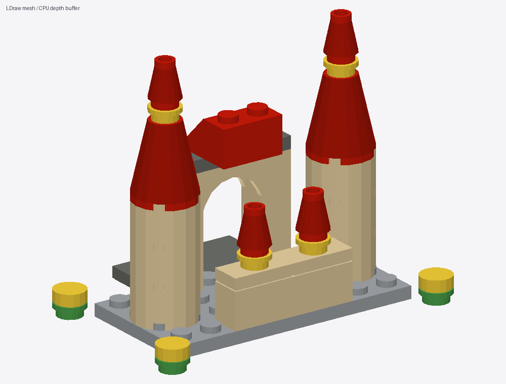

# LEGOWorld v0.2

自然语言设计乐高：**通用多模态 Agent → MCP 搭建 → 几何碰撞检查 → 图片反馈 → 局部修改 → Studio `.io` / `.mpd`**。

第二版保留 [BrickBuilderMCP](https://github.com/jonx/BrickBuilderMCP) 的单份模型状态，接入 [BrickNet](https://github.com/kulits/BrickNet) 凸分解碰撞体和 PyBullet；预览改为读取官方 LDraw 实际三角面，由本地 CPU 深度缓冲渲染。斜面、圆形、圆锥、拱洞和底部空腔不再统一画成方盒。



[Studio IO](examples/v2_castle_gate/model.io) · [MPD](examples/v2_castle_gate/model.mpd) · [四视图](examples/v2_castle_gate/preview.png) · [验证记录](docs/VERIFICATION.md) · [实现和论文借鉴](docs/V2.md)

## 第二版能力

- 目录从 **32 种增加到 60 种**，新增 28 种：斜坡、曲面坡、拱门、圆砖、圆板、圆锥、转角板、跳线板等。完整列表见 [目录说明](docs/V2.md)。
- 实际凸碰撞体检查，沿用 BrickNet 的 **1 LDU 穿透容差**。包围盒相交不再直接判为碰撞。缺失碰撞体会显示未验证并阻止最终导出。
- 使用测得的直立凸点/接收孔位置；斜坡、拱门和跳线板不再假设完整凸点网格。
- 增加连接点查询/吸附、放置预检、零件检查/替换、整组移动旋转、尺寸测量和自选角度/局部渲染。替换与整组变换失败时恢复原状态。
- 检查、渲染、审查、导出共用同一模型。导出按零件分别转换 LDraw 原点，覆盖斜坡和转角件的水平偏移。
- 自然语言理解、看图和审美调整仍由 Claude Code 等外部 Agent 完成，本服务不持有 API key、不直接调用模型 API。

## 本机直接运行

仓库当前 `.venv` 已安装第二版依赖，几何和碰撞资产位于 `.cache/assets/`：

```powershell
.\.venv\Scripts\python.exe -X utf8 -m legoworld doctor
.\.venv\Scripts\python.exe -X utf8 -m legoworld demo-v2
.\.venv\Scripts\python.exe -X utf8 -m pytest -q
```

`demo-v2` 是可复现的工具链示例，不调用 LLM。它生成 39 件城堡门楼，演示重叠预检、局部替换、四视图及 IO/MPD 导出。输出在 `outputs/v2_castle_gate/`。

已有 Claude Code MCP 配置继续指向同一 Python/模块入口；**重连 MCP 或重启 Claude Code** 以重新发现工具。可用以下命令生成配置参考，再按客户端格式合并，不会自动覆盖现有配置：

```powershell
.\.venv\Scripts\python.exe -m legoworld mcp-config
```

让 Agent 读取 [建模 skill](skills/lego-builder/SKILL.md)，从 `create_model` 开始，调用 `get_connectors` / `attach_part` 放置细节，调用 `review_model` 并实际查看图片，最后 `export_model`。新示例任务见 [prompts](examples/prompts.md)。

## 从新环境安装

推荐 **Python 3.12**，只安装到仓库虚拟环境：

```powershell
.\scripts\setup.ps1 -Python <Python3.12的完整路径> -Precision
.\.venv\Scripts\python.exe -X utf8 -m legoworld fetch-assets
.\.venv\Scripts\python.exe -X utf8 -m legoworld doctor
```

也可先创建 `.venv`，再 `python -m pip install -e '.[dev,precision]'`。Windows/Python 3.12 的 PyBullet 3.2.7 可能需要从源码编译，需 Visual Studio C++ Build Tools；本机已实际编译成功。几何资产下载约 **330 MiB**，包含 191 MiB 的凸碰撞体归档，解压后需约 2 GB 空间。下载不会在 MCP 启动时自动执行。

可通过环境变量指定资产路径：

| 变量 | 用途 |
| --- | --- |
| `LEGOWORLD_ASSETS` | 总资产目录，默认仓库 `.cache/assets` |
| `LDRAW_LIBRARY_PATH` | 已安装的 LDraw 根目录，内含 `parts/` 和 `p/` |
| `BRICKNET_DATA` | 碰撞数据根目录，内含 `cvx/` |
| `LEGOWORLD_COLLISION` | 默认 `bricknet`；`aabb` 为显式简化回退 |
| `LEGOWORLD_RENDERER` | 默认 `ldraw`；`boxes` 为简化方盒回退 |

没有安装精细依赖和资产时，可使用 `setup.ps1` 基础安装，并设置以下回退模式：

```powershell
$env:LEGOWORLD_COLLISION = 'aabb'
$env:LEGOWORLD_RENDERER = 'boxes'
```

此模式明确返回 `verified: false`，其导出仅通过保守 AABB 和凸点检查。修改环境变量后重启 MCP；客户端也可以在 MCP 配置的 `env` 中注入这些变量。

## 工具与输出

新增工具：`get_connectors`、`attach_part`、`preview_placement`、`replace_part`、`transform_group`、`inspect_part`、`measure_model`、`render_view`。既有零件搜索、放置、连接建议、墙/房间构建、检查点、审查和导出仍可用。连接建议也已改为实际连接点枚举。

坐标为 LDU：20/凸点、8/板、24/砖；**负 Y 向上，放置坐标为底部原点**。使用 `get_part_info` 查看不熟悉零件的尺寸、原点和连接点。

```text
outputs/<作品名>/
  model.io              # 基础 Studio ZIP，内含标准 LDraw 模型
  model.mpd             # 标准 LDraw 模型
  preview.png           # 四视图
  validation.json       # 碰撞、连接、网格检查
  result.json           # 导出路径与实际后端
  iterations/001/...    # 每轮模型、图片、报告
```

`load_model` 可恢复本项目导出的基础 IO/MPD。其他 Studio 项目请先导出 MPD；仅接受当前 60 种零件和直立的四种水平朝向。IO 不保留说明书、完整 modelv2 元数据、定制零件或材质设置。文件容器和坐标已测试；**实际用 Studio 打开、编辑、另存仍需人工验收**。

## 当前边界与回退

支持直立凸点连接及四分之一圈水平旋转；暂不支持侧向 SNOT、铰链、夹杆、轴孔等连接求解，也不进行夹持力、承重或变形仿真。凸分解是几何近似，1 LDU 容差内的穿入会被接受。预览使用实际零件网格，但采用不透明平面着色，没有 Studio 的光追、透明材质和阴影效果；大模型会更慢，可用 `render_view` 单独观察局部。

Git 第一版基线为标签 `v0.1.0`（`5d81d85`），第二版位于 `feat/v0.2-precision`。已保存本地改动后，可 `git switch --detach v0.1.0` 查看第一版；返回 `git switch feat/v0.2-precision`。这不会回退虚拟环境中的依赖，第一版工具仍兼容当前环境。也可保留第二版代码，仅使用上面的两个环境变量切换简化后端。

开发说明和第三方来源见 [AGENTS.md](AGENTS.md)、[V2.md](docs/V2.md) 与 [THIRD_PARTY.md](THIRD_PARTY.md)。
