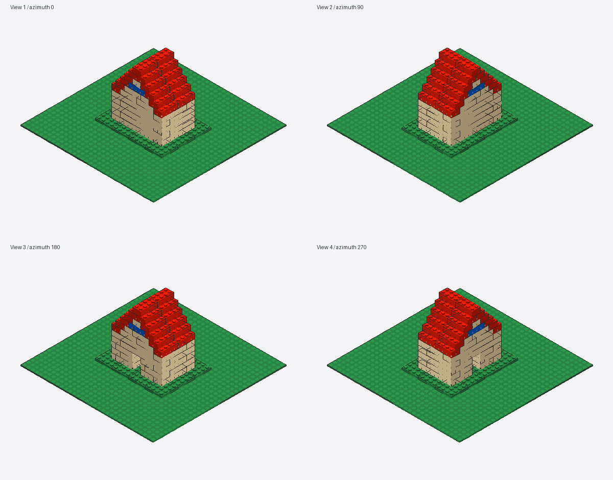

# LEGOWorld MVP

自然语言设计乐高模型：**通用多模态 Agent → MCP 搭建 → 冲突检查 → 四视图反馈 → 修改 → 导出 Studio `.io` / `.mpd`**。

复用 [BrickBuilderMCP](https://github.com/jonx/BrickBuilderMCP) 的建模、连接、AABB 检查和 Pillow 渲染；固定上游提交 `f397a80993e6e2d36aed50b96d2b6f7200fc1694`。本仓库提供精简的 MCP 工具集合、四视图审查、迭代记录、Studio 坐标适配和文件导出。



已生成的 [Studio IO 示例](examples/reviewed_house/model.io)、[MPD 示例](examples/reviewed_house/model.mpd)和[实际验证记录](docs/VERIFICATION.md)。示例是 73 件小房子：本会话看图后通过 MCP 补齐山墙并增加蓝色装饰。

## 首版范围

- 单个本地模型、上游内置常用砖/板/光面板/底板，无需下载完整 LDraw 库。
- 普通凸点连接、水平四分之一圈旋转；适合小房子、灯塔等静态模型。
- 检查穿插、悬空、未锚定、未知零件和网格位置；渲染返回真实 MCP `image` 内容块。
- `.io` 与 `.mpd` 从同一份模型导出。修正上游底面原点到 LDraw 顶面原点的偏移，避免砖与薄板混用时错位。
- 视觉美化和自然语言理解由你连接的 Agent 完成。本服务本身不调用模型 API。

碰撞采用 AABB、连接采用简化凸点网格；不是任意零件精确网格碰撞或完整力学仿真。说明书、复杂机构、网页界面和实时控制 Studio 留给后续版本。

## 安装与离线验证（Windows PowerShell）

需要 Python 3.10+。只在仓库 `.venv` 中安装依赖：

```powershell
.\scripts\setup.ps1 -Python python
# 默认 python 过旧时，通过 -Python 指定新版解释器的完整路径。
.\.venv\Scripts\python.exe -m legoworld doctor
.\.venv\Scripts\python.exe -m legoworld demo
.\.venv\Scripts\python.exe -m pytest -q
```

Linux/macOS 可用 `python3 -m venv .venv`、`.venv/bin/python -m pip install -e '.[dev]'`，之后使用该解释器运行同样的模块命令。

`demo` 是**确定性离线验收**：搭小房子 → 故意加入重叠零件 → 检出问题 → 移除冲突 → 四视图 → 导出。它不冒充自然语言或自主审美测试，也不需要模型 API key。

## 接入通用 Agent

1. 使用支持 MCP stdio 和工具返回图片的多模态 Agent。
2. 在仓库根目录生成配置，使用其中的绝对解释器路径与工作目录参数：

   ```powershell
   .\.venv\Scripts\python.exe -m legoworld mcp-config
   ```

   输出为常见的 `mcpServers` JSON 结构。合并到你所用客户端的 MCP 配置；不同客户端可能需要转换外层结构。不要把它当作所有客户端通用的配置文件。

3. 启动或重连客户端，确认能列出 `review_model` 和 `export_model`。
4. 让 Agent 读取 `skills/lego-builder/SKILL.md`，然后输入 `examples/prompts.md` 中的小房子任务。
5. 确认它真的收到并分析四视图，再修改、重新审查和导出。只看到图片路径还不算视觉循环通过。

手动启动服务：

```powershell
.\.venv\Scripts\python.exe -m legoworld serve --workspace .
```

这是 MCP stdio 服务，会等待客户端发送协议消息，不是命令行聊天界面。

## 输出与继续编辑

```text
outputs/<作品名>/
  model.io             # 基础 Studio 项目
  model.mpd            # 标准 LDraw 模型
  preview.png          # 四视图
  validation.json      # 最终基础检查
  result.json          # 导出结果
  iterations/001/...   # 每轮 MPD、图片、检查及审查说明
```

`load_model` 可以恢复本项目导出的基础 `.io` / `.mpd`。对其他 Studio 项目，先在 Studio 导出 MPD；超出首版零件目录的模型会被拒绝。首版不保留外部 Studio 项目的说明书、缩略图、定制零件或完整 modelv2 元数据。

在 Studio 中打开 `model.io`，核对零件数量、颜色、砖/薄板连接，移动一个零件后另存为项目；同时可以打开 `model.mpd` 比较。**文件结构与坐标测试不代替实际 Studio 打开验收**。

## 3–4 天推进顺序

1. 工具、冲突检测、渲染、MPD/IO 导出与 Studio 打开。
2. 通用 Agent 接入，确认图片进入视觉通道并修复一次冲突。
3. 小房子/塔等任务的视觉修改与有限轮次迭代。
4. 根据失败案例修复并整理复现记录。

## 开发

主要入口为 `src/legoworld/server.py`；导出适配为 `studio_io.py`。检查、渲染和导出共用上游的一份 `STATE`，不再运行第二个模型服务。

上游为 MIT 许可，本项目通过固定版本依赖引用它；不复制其他仓库的未授权代码。`.io` 容器布局参考公开文件实现，独立使用 Python 标准库实现基本新项目写入。当前版本没有引入 Studio 原生进程桥接。
