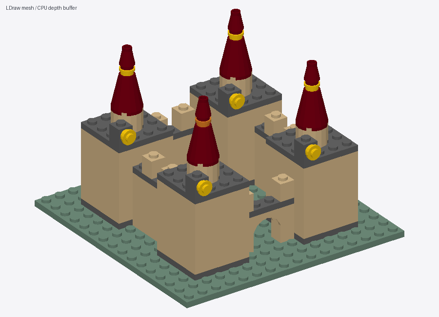

# V3 modular castle

264 pieces, generated by [castle_v3.py](../builds/castle_v3.py) and refined with one
transactional local recolor. Uses shared tower/wall definitions, native SNOT
connectors and an explicitly checked second arch support.

[IO](model.io) · [MPD](model.mpd) · [Four views](preview.png) ·
[Checks](validation.json) · [Deterministic timing](benchmark.json)

The full project JSON, source snapshots and revision history are generated under
local outputs by `python -m legoworld demo-v3`. These checked-in files demonstrate
the deterministic chain; they do not evaluate an autonomous LLM's design quality.
LDraw geometry attribution is in [THIRD_PARTY.md](../../THIRD_PARTY.md).
